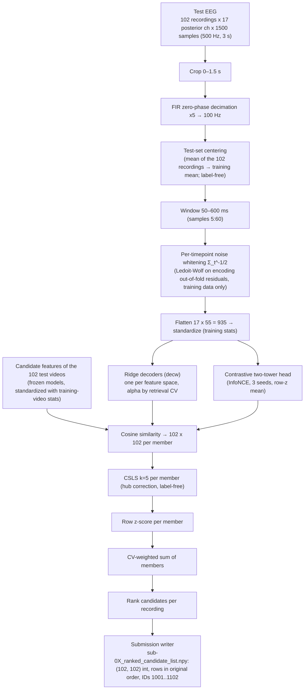

# Architecture of the final pipeline

**Task.** EEG was recorded (17 posterior channels, 500 Hz, 3 s) while people watched 3 s video clips with sound. For each
test recording, rank the 102 test videos (IDs 1001–1102, never seen in training) from most to least likely. The design is
**zero-shot retrieval**: we learn a map from EEG into frozen video/audio feature spaces, then match.

**Headline submission:** `submissions/final_csls/` (track-matching `7297a59`, experiment `fin5_ctr_m5`): dev (sub-01..04)
**24.0% top-1 / 57.1% top-5 / median rank 4.25** (chance 1.0 / 4.9), leave-one-fold-out train-CV 0.21235. Audited
(AUDIT.md). Realistic projection for the scored sub-05/06 (the two weakest subjects by CV): **~15% / ~40%** (AUDIT.md §5).
Numbers below come from MODEL_BACKLOG.md (M-IDs), AUDIT.md and PROGRESS.md.

## 1. Data flow

Every fitted quantity (whiteners, scalers, ridge maps, alphas, contrastive weights, early stopping, ensemble weights) comes
from the subject's **training** recordings only. Test EEG and test-video features enter only at scoring; centering and
CSLS use only the unlabeled test set (CSLS approved by the organizers). Dev labels are read only after the files are
written (AUDIT.md §4).

**Why each step is there** (dev top-1, cumulative): the organizers' AlexNet encoding recipe, re-implemented, 2.0% (M0) →
fixing a scaler bug that made ridge alpha a no-op, 5.4% (M2) → **decoding** EEG → features instead of predicting EEG,
14.0% (M3) → **noise-whitened** input, 14.7% / 42.2% (M8a) → CV-weighted **ensemble** of feature spaces, 20.8% (M17) →
centering + **CSLS**, 24.0% / 57.1% (final_csls). The useful signal sits in 50–600 ms; wider windows hurt.

## 2. Member families

| Family | Member (cache name) | Model / version | What it contributes | In headline | In v3 candidate* |
|---|---|---|---|---|---|
| Semantic image | `decw:dinov2_b_patch_all` | DINOv2 ViT-B/14, timm `vit_base_patch14_dinov2.lvd142m`, mean of patch tokens, 8 frames | strongest single member by CV (M10); object/scene structure | **0.4** | yes |
| Semantic image | `decw:clip_b32` | open_clip ViT-B-32 `laion2b_s34b_b79k`, 8-frame mean | first strong member (M3/M8a: 14.7 / 42.2 alone); weight 0 once DINOv2/V-JEPA are in | 0.0 | – |
| Semantic, mid-level | `decw:clip_b32_mid8_all` | same CLIP, CLS after block 8 of 12 | intermediate-depth view (M18) | **0.1** | – |
| Temporal video | `decw:vjepa2_l_all:16` | V-JEPA 2 ViT-L `facebook/vjepa2-vitl-fpc64-256` rev `b3c1679b…`, 16 frames | video dynamics; adds as a third decoder (M16/M17) | **0.3** | yes |
| Trained objective | `con:clip_b32:two_tower_d256` | InfoNCE two-tower head on CLIP targets, 3 SGD seeds | weak alone, complementary errors (M12/M13) | **0.2** | yes |
| Low-level spatial | `decw:alexnet_p6` (conv2) / `decw:alexnet_c5p6` (conv5) | torchvision AlexNet `IMAGENET1K_V1`, pooled 6×6, 8 frames | posterior electrodes track edges/contrast/layout; conv2 member +5.4 pts top-1 over the headline (ALEXNET_FINDINGS.md, 24.0 → 29.4) | – | conv5 |
| Hand-crafted | `decw:lowlevel_all:1` | colour, spatial-frequency, edge and motion descriptors (`eegmr.lowlevel`, no model) | interpretable low-level statistics | – | yes |
| Low-level AV over time | `decw:lowav_all:1` | per-100 ms luminance / contrast / edges / motion + RMS / onset / 8 mel bands (`eegmr.audio`, no model) | largest single weight in M21 (0.3); time-resolved low-level drive | – | yes |
| Audio | `decw:clap_all:1` | LAION-CLAP `laion/clap-htsat-unfused` rev `8fa0f1c6…` | the clips have sound; low overlap with vision (RSA 0.18 vs CLIP) (M20) | – | yes |

*v3 candidate (`final_v3_csls`, experiment `v3_ctr_m5`, krabiki-51): members as listed, **weights and numbers TBD**.
Related unaudited results: M21 (M17 + CLAP + lowav, CSLS) 29.4% / 64.5%; M22 (+ AlexNet conv2) 33.1% / 67.9%. They are
not the submission until they pass the AUDIT.md checks.

**Tried and not used** (MODEL_BACKLOG.md): encoding models as members (M5/M9), reliability-weighted cosine (M8b:
CV preferred it, dev did not confirm), more frames / onset pooling (M6), CLIP L-14 (M18), nonlinear EEG encoders standalone
(M14: EEGNet is data-limited; a small gain as a member), zero-shot transfer from THINGS-EEG2 (M15), motion gating (M23).

## 3. Selection protocol

1. **Training-only CV** per subject: 5 folds over the training videos (`KFold(5, shuffle=True, random_state=0)`).
   Whiteners and matchers are re-estimated inside each fold. Score = mean percentile rank of the true video and expected
   top-1 / top-5 among 102 candidates (hypergeometric).
2. **Alphas** by retrieval CV on each subject's training set (the decoder's alpha nested for the whitened input).
3. **Ensemble weights** on the simplex (steps of 0.1): exhaustive for ≤ 5 members (≤ 6 in the final grid), steepest-ascent
   pair transfers beyond that, maximizing (E[top-1] + E[top-5]) / 2.
4. **Strategy by leave-one-fold-out** (weights picked on 4 folds, scored on the 5th): best single / equal / global /
   per-subject; **the simplest strategy within 0.0005 of the best wins** (complexity tie-break). A member is kept only if it
   adds more than ~0.002 LOFO like for like.
5. **Dev (sub-01..04 test sets) only to confirm**, with a paired Wilcoxon on 408 per-trial ranks. Caveat (AUDIT.md §4):
   the *candidate set* (window, centering, CSLS, member pool) was screened on dev several times, so dev is an optimistic
   estimate for sub-05/06.

## 4. Training vs inference

- **Training** (GPU, `scripts/ensemble.py`): extract frozen features once (`scripts/extract_features.py`,
  `scripts/extract_audio.py`, `scripts/lowlevel_features.py`), fit all members per subject, choose the weights by CV,
  write the submissions. About 20 s per subject per whitened decoder on the GPU.
- **Inference bundle** (`scripts/export_bundle.py` → zip, not in git): per subject and member the whiteners, standardization
  stats, the ridge map B = V·diag(S/(S²+α))·Uᵀ(Y − ȳ) or the contrastive projections, the training EEG mean, plus the 102
  candidate vectors. `scripts/infer_bundle.py` needs **only numpy + scipy** (CPU, e.g. a MacBook). It reproduces
  `final_csls` sub-05/06 **bit-identically** and dev 24.0 / 57.1 in 1.6 s for six subjects.

## 5. Code map

| Where | What |
|---|---|
| `src/eegmr/data.py`, `evaluate.py`, `submission.py` | loading, decimation; top-k / median rank; the validated submission writer |
| `src/eegmr/features.py`, `lowlevel.py`, `audio.py` | frozen extractors (CLIP, DINOv2, V-JEPA, AlexNet, descriptors, low-level AV, CLAP) and caches |
| `src/eegmr/linear.py`, `decoding.py`, `contrastive.py`, `stage3.py`, `matching.py` | encoding / decoding ridge, whitened decoder, InfoNCE heads, EEGNet, matching variants |
| `src/eegmr/gpu.py`, `retrieval.py` | torch ridge / retrieval-CV helpers (parity-tested vs sklearn); CSLS |
| `scripts/ensemble.py`, `predict.py` | CV-weighted ensemble (final pipeline); single model → submission |
| `scripts/export_bundle.py`, `infer_bundle.py`, `audit_*.py`, `audit_runbook.sh` | bundle; audit controls |
| Branches | `track-proven` (integration + shared tooling), `track-matching` (ensembles, final sets), `track-dinov2`, `track-vjepa`, `track-audio` (Alikhan), `track-alexnet`, `main` (Azamat's time-staged track) |

## 6. Reproducibility

- **Environment:** Python 3.11.17; every third-party import pinned in `requirements.txt` and equal to the installed
  versions (numpy 2.4.6, scipy 1.17.1, scikit-learn 1.9.1, torch 2.11.0+cu128, open_clip 3.3.0, timm 1.0.30,
  transformers 5.18.0, av 18.1.0 for audio).
- **Models:** V-JEPA 2 and CLAP are revision-pinned; AlexNet uses a versioned torchvision file. CLIP B-32 and DINOv2 are
  loaded by tag (cached snapshots `1a25a446…`, `4685c99d…` recorded; pinning is a consolidation TODO). V-JEPA 2 runs in
  fp16, and the all-frame caches store fp16 embeddings.
- **Determinism and controls** (AUDIT.md §4): from-scratch reruns are bit-identical (test and CV side, including the
  contrastive seeds); permuting the test recordings permutes the output rows exactly; training on shuffled EEG–video
  pairs gives chance (1.0 / 4.7); the committed sub-05/06 files equal a fresh rerun.
- **Data rules:** no organizer code; external models are public and released before 2026-10-16; the EEG Moments / BOLD
  Moments datasets are never used (CLAUDE.md).
